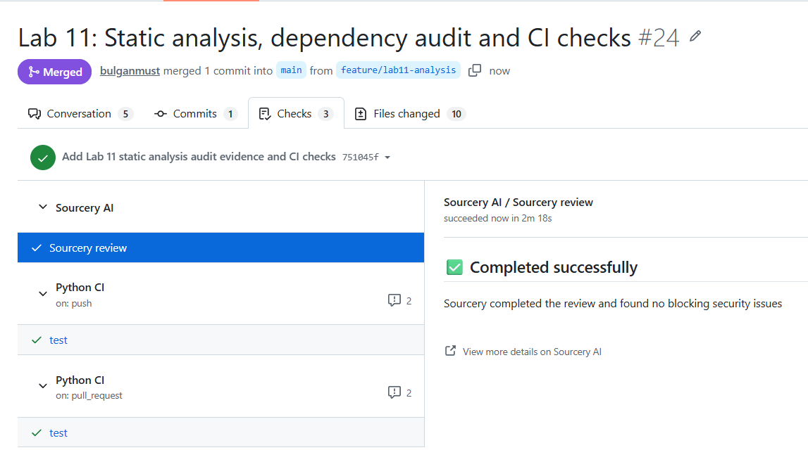

\# Лаборатори 11 — Статик шинжилгээ, эмзэг байдал илрүүлэх


\*\*Хичээл:\*\* CS316 — Программ хангамж хөгжүүлэлтийн процесс


\*\*Төсөл:\*\* Intercity — Хот хоорондын тээвэр ба хүргэлт


\## 1. Багийн бүрэлдэхүүн


| Гишүүн | Оюутны код |

|---|---|

| Ж.Булган | B232270062 |

| Ж.Буянхишиг | B232270114 |

| Э.Бүрэнбаяр | B242270084 |


\## 2. Зорилго


Python кодыг Pylint хэрэгслээр шинжилж, илэрсэн асуудлуудыг засах, npm dependency-ийн эмзэг байдлыг шалгах, шалгалтуудыг GitHub Actions-д холбох.


\## 3. Хамрах хүрээ


| Шалгалт | Хамруулсан файл / хавтас |

|---|---|

| Python статик шинжилгээ | lab6/booking.py |

| Тестийн кодын статик шинжилгээ | lab10/tests/test\_booking.py |

| Dependency audit | lab8/package.json, lab8/package-lock.json |

| Зан төлөвийн шалгалт | Lab 6 болон Lab 10-ын 24 тест |


Ашигласан орчин: Python 3.12.10, Pylint 4.1.3, Node.js 24.14.0, npm 11.9.0.


\## 4. Анхны шалгалт ба орчны асуудал


Анхны Pylint ажиллуулалтад импортын алдаа болон хэрэгслийн дотоод алдаа гарсан. Тиймээс тухайн ажиллуулалтын 0.00/10 үнэлгээг кодын чанарын харьцуулалтын суурь болгоогүй.


Python-оор lab6.booking модулийг импортлоход амжилттай ажилласан. Төслийн үндсэн хавтсыг Pylint-ийн импортын замд нэмсэн дараагийн ажиллуулалтад импортын болон дотоод алдаа дахин гараагүй.


Харьцуулалтад ашигласан команд:


```bat

python -m pylint --init-hook="import sys; sys.path.insert(0, '.')" lab6/booking.py lab10/tests/test\_booking.py

```


Энэ ажиллуулалтын үнэлгээ 6.77/10 байсан.


\## 5. Илэрсэн асуудал ба шийдэл


| Код | Тоо | Асуудал | Шийдэл |

|---|---|---|---|

| C0114 | 1 | Тестийн модулийн тайлбар байхгүй | Модулийн docstring нэмсэн |

| C0116 | 6 | Тестийн функцүүдийн тайлбар байхгүй | Зургаан функцэд docstring нэмсэн |

| C0304 | 1 | Файлын төгсгөлийн шинэ мөр байхгүй | Шинэ мөр нэмсэн |

| C0123 | 2 | type() ашигласан төрлийн шалгалтын санал | Зориудын шалгалтын үндэслэлийг тайлбарлаж, тухайн мөрөнд чөлөөлсөн |


Нийт 10 convention мэдэгдэл гарсан. Эдгээр нь Pylint-ийн кодын хэв маягийн ангилал бөгөөд Critical, High зэрэг аюулгүй байдлын зэрэглэлтэй адил биш.


\### C0123 саналыг яагаад шууд дагаагүй вэ?


Python-д bool нь int-ийн дэд төрөл тул isinstance(True, int) нь True буцаана. Манай дүрэм суудлын тоонд зөвхөн яг int төрөл зөвшөөрдөг.


Тиймээс type(value) is int шалгалтыг хэвээр үлдээж, зан төлөвийг өөрчлөөгүй. Дараах тайлбар болон зөвхөн дараагийн мөрд үйлчлэх чөлөөлөлтийг нэмсэн:


```python

&#x20;   # Exact int checks intentionally reject bool and int subclasses.

&#x20;   # pylint: disable-next=unidiomatic-typecheck

&#x20;   if type(seat\_count) is not int or type(available\_seats) is not int:

&#x20;       return False

```


Бусад Pylint дүрмийг бүхэлд нь идэвхгүй болгоогүй.


\## 6. Өмнөх ба дараах үр дүн


| Үзүүлэлт | Засварын өмнө | Засварын дараа |

|---|---|---|

| Pylint үнэлгээ | 6.77/10 | 10.00/10 |

| Модулийн тайлбар | Байхгүй | Нэмсэн |

| Функцийн тайлбар | Зургаан тестэд байхгүй | Нэмсэн |

| Төгсгөлийн шинэ мөр | Байхгүй | Нэмсэн |

| Төрлийн шалгалт | Зориудын боловч тайлбаргүй | Үндэслэлтэй тайлбар, мөрийн чөлөөлөлттэй |


!\[Pylint өмнөх ба дараах харьцуулалт](evidence/pylint-comparison.png)


\- \[Засварын өмнөх хүчинтэй шалгалт](evidence/pylint-diagnostic.txt)

\- \[Засварын дараах шалгалт](evidence/pylint-after.txt)


10.00/10 үнэлгээ нь сонгосон файлууд идэвхтэй дүрмүүдийг хангасныг харуулна. Программ бүхэлдээ алдаагүй эсвэл аюулгүй гэдгийг батлахгүй.


\## 7. Засварын дараах тест


```bat

python -m pytest lab6/tests lab10/tests -v

```


Бодит үр дүн:


```text

24 passed in 0.17s

```


Ингэснээр тайлбар болон Pylint чөлөөлөлт нэмсний дараа одоо байгаа 24 тест амжилттай хэвээр байгааг шалгасан.


\## 8. npm audit


Ажиллуулсан команд:


```bat

npm --prefix lab8 audit --json

```


\[Audit тайлан](evidence/npm-audit.json)


| Зэрэглэл | Илэрсэн тоо |

|---|---|

| Critical | 0 |

| High | 0 |

| Moderate | 0 |

| Low | 0 |

| Info | 0 |

| Нийт | 0 |


Lab 8-ын апп нэмэлт npm dependency-гүй. Тиймээс шинэчлэх шаардлагатай эмзэг npm package илрээгүй бөгөөд dependency-ийн засвар хийгээгүй.


Энэ үр дүн нь Python сангууд, Node.js runtime, Docker суурь image болон аппын бизнес логикийн аюулгүй байдлыг хамрахгүй.


\## 9. CI-д холбосон нь


.github/workflows/ci.yml файлд дараах шалгалтуудыг тохируулсан:


1\. Python тестүүдийг ажиллуулах.

2\. Сонгосон Python файлуудад Pylint ажиллуулах.

3\. Node.js орчин бэлтгэх.

4\. Lab 8-ын npm dependency audit ажиллуулах.


Pylint-ийн хувилбарыг lab11/requirements.txt файлд тогтоосон:


```text

pylint==4.1.3

```


CI-д ашиглах командууд:


```bat

python -m pip install -r lab7/requirements.txt -r lab11/requirements.txt

python -m pytest lab6/tests lab10/tests -v

python -m pylint --init-hook="import sys; sys.path.insert(0, '.')" lab6/booking.py lab10/tests/test\_booking.py

npm --prefix lab8 audit --audit-level=low

```


### CI-ийн үр дүн

PR #24-ийн push болон pull_request шалгалтууд амжилттай дууссан.



\## 10. Дүгнэлт


Pylint-ээр илэрсэн тайлбар болон файлын хэлбэрийн асуудлуудыг засаж, үнэлгээг 6.77-оос 10.00 болгосон. Зориудын төрлийн шалгалтыг үндэслэлтэйгээр хэвээр үлдээж, 24 тест амжилттай ажилласнаар өмнөх зан төлөв хадгалагдсаныг шалгав. npm audit-аар эмзэг dependency илрээгүй бөгөөд уг үр дүнгийн хамрах хүрээг тайланд тодорхойлов.

