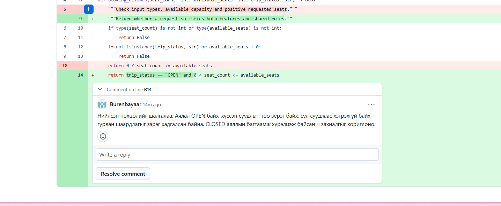
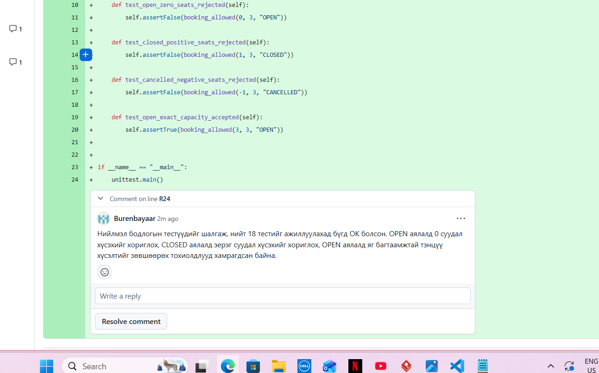
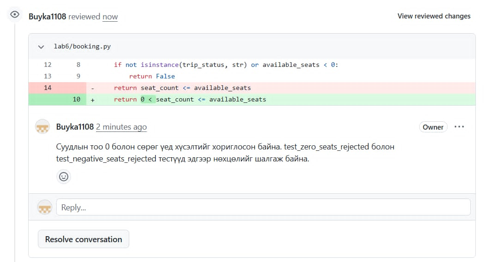
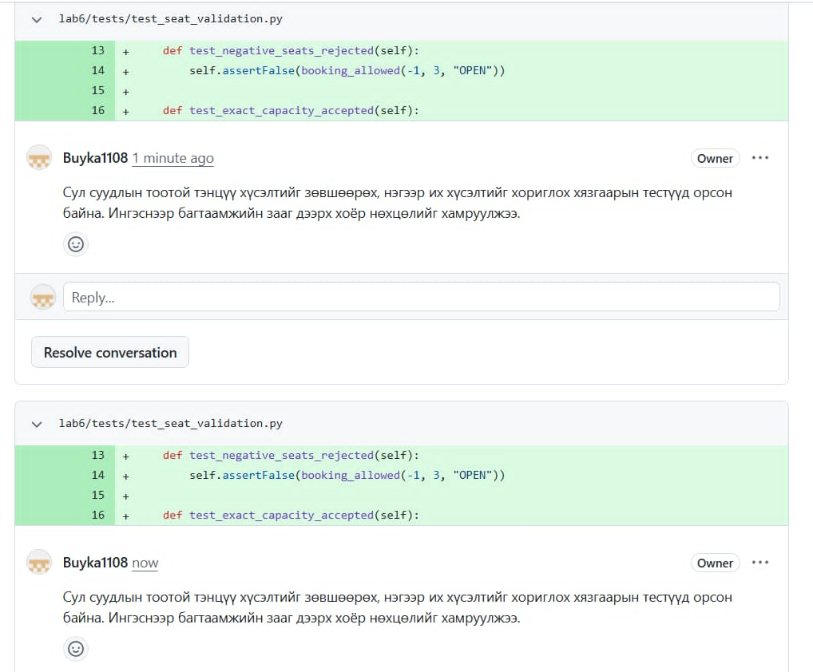

# Лаборатори 6 — Git branch, merge conflict ба code review-ийн тайлан

**Төсөл:** Хот дотор, хот хоорондын тээвэр ба хүргэлтийн үйлчилгээ
**Repository:** https://github.com/Buyka1108/intercity-transport-delivery
**Гүйцэтгэсэн хугацаа:** 2026.10.22–2026.10.23, Улаанбаатарын цагаар

## 1. Гүйцэтгэлийн төлөв

Хоёр feature branch, хоёр PR, бодит merge conflict болон түүний шийдэл main-д орсон. Эцсийн 18 unit test амжилттай болсон. Буянхишиг `Buyka1108` бүртгэлээр PR #17-ийн код, тестийг хянаж хоёр өөр утгатай санал бичсэн. Шинээр өгсөн хоёр screenshot-д Бүрэнбаяр `Burenbayaar` бүртгэлээр PR #18-ийн код болон нийлмэл бодлогын тест дээр хоёр өөр агуулгатай comment нийтэлсэн нь харагдсан.

Иймээс **код, merge, тестийн дасгал гүйцэтгэсэн; хоёр PR дээр тус бүр хоёр агуулгатай хүний comment бүрдсэн; харин merge-ээс өмнөх review-ийн дараалал болон энэ тайлангийн remote илгээлтийг бүрэн дууссан гэж тэмдэглээгүй**. Энэ файлыг локал орчинд бэлтгэсэн нь GitHub руу push хийсэн эсвэл хичээлийн системд илгээсэн гэсэн үг биш.

## 2. Багийн оролцоо ба бүртгэл

| Гишүүн | Нотлогдсон оролцоо | Үндэслэл |
|---|---|---|
| Ж.Булган — `bulganmust` | Branch, commit, push, PR, merge ажиллагааг нэгтгэсэн | Хэрэглэгчийн терминалын түүх; PR #17, #18-ийн author `bulganmust` |
| Ж.Буянхишиг — `Buyka1108` | Суудлын 0/сөрөг тооны дүрэм, багтаамжийн заагийн тестүүдийг хянаж review бичсэн | PR #17-ийн comment permalink, review, хоёр screenshot |
| Э.Бүрэнбаяр — `Burenbayaar` | PR #18-ийн нийлмэл захиалгын нөхцөл, заагийн тестүүдийг хянаж хоёр санал нийтэлсэн; 18 тест OK болсныг мэдээлсэн | Код болон тестийн comment харагдах хоёр screenshot, хэрэглэгчийн тестийн үр дүн |

Баг нэг компьютер дээр хамтран ажилласан. Feature commit-уудын Git author нь `Zolbo` гэж бүртгэгдсэн бөгөөд үүнийг гишүүн тус бүрийн бие даасан commit гэж хувааж тооцоогүй. Хоёр өөр хүн feature тус бүрийг бие даан хэрэгжүүлсэн байх шалгуурын хувьд хамтын ажлын хэлбэр, хувь хүний оролцоог тусад нь тайлбарлана.

## 3. Feature branch, commit ба PR

| Үзүүлэлт | Seat validation | Trip status |
|---|---|---|
| Branch | `feature/seat-validation` | `feature/trip-status` |
| Зорилго | Суудлын тоо эерэг, сул суудлаас хэтрэхгүй байх | Зөвхөн OPEN аялалд захиалга зөвшөөрөх |
| Feature commit | [c224936](https://github.com/Buyka1108/intercity-transport-delivery/commit/c224936) | [f457a77](https://github.com/Buyka1108/intercity-transport-delivery/commit/f457a77) |
| PR | [#17](https://github.com/Buyka1108/intercity-transport-delivery/pull/17) | [#18](https://github.com/Buyka1108/intercity-transport-delivery/pull/18) |
| Merge commit | [579b9ad](https://github.com/Buyka1108/intercity-transport-delivery/commit/579b9ad) | [df3c622](https://github.com/Buyka1108/intercity-transport-delivery/commit/df3c622) |
| Main-д орсон цаг | 2026.10.22 22:23:40, UTC+08 | 2026.10.22 22:33:02, UTC+08 |
| Төлөв | Merged | Merged |

Суурь эхийг [8fbb7a8](https://github.com/Buyka1108/intercity-transport-delivery/commit/8fbb7a8) commit-оор нэмсэн.

## 4. Conflict үүссэн шалтгаан ба шийдэл

`feature/trip-status` branch дээр дараах командыг ажиллуулахад conflict гарсан:

```console
git merge origin/main
Auto-merging lab6/booking.py
CONFLICT (content): Merge conflict in lab6/booking.py
Automatic merge failed; fix conflicts and then commit the result.
```

Хоёр feature `lab6/booking.py` файлын ижил `return` мөрийг өөр өөр шаардлагаар өөрчилсөн. Нэг талын өөрчлөлтийг дангаар сонговол нөгөө шаардлага алдагдах тул хоёр дүрмийг `and` нөхцөлөөр нэгтгэсэн:

```python
return trip_status == "OPEN" and 0 < seat_count <= available_seats
```

Нийлмэл бодлого нь OPEN аялал, эерэг суудлын тоо, хүрэлцэх багтаамж гэсэн бүх нөхцөлийг зэрэг шаарддаг. Хаалттай аяллын багтаамж хүрэлцэж байсан ч хүсэлтийг хориглоно. OPEN аялал байсан ч 0, сөрөг, эсвэл багтаамжаас их хүсэлтийг хориглоно.

Шийдлийг [f733204](https://github.com/Buyka1108/intercity-transport-delivery/commit/f733204) commit-оор хадгалж, нийлмэл дүрмийн дөрвөн тест нэмсэн.

Conflict-ийн нотолгоо: терминалын merge алдаа болон [шийдлийн commit f733204](https://github.com/Buyka1108/intercity-transport-delivery/commit/f733204).

## 5. Багийн бодит review

| PR / файл | Reviewer | Бодит comment холбоос | Хянасан зүйл |
|---|---|---|---|
| #17, `lab6/booking.py` | `Buyka1108` — Ж.Буянхишиг | [Санал 1](https://github.com/Buyka1108/intercity-transport-delivery/pull/17#discussion_r4350606793) | 0 болон сөрөг суудлыг хориглосон дүрэм, тэдгээрийн тест |
| #17, `lab6/tests/test_seat_validation.py` | `Buyka1108` — Ж.Буянхишиг | [Санал 2](https://github.com/Buyka1108/intercity-transport-delivery/pull/17#discussion_r4350620360) | Багтаамжтай тэнцүү хүсэлт зөвшөөрөх, нэгээр их хүсэлт хориглох зааг |

[Нийтэлсэн review](https://github.com/Buyka1108/intercity-transport-delivery/pull/17#pullrequestreview-5617143227) нь `COMMENTED` төлөвтэй. Хоёр дахь санаа [давтан нийтлэгдсэн](https://github.com/Buyka1108/intercity-transport-delivery/pull/17#discussion_r4350627159) тул гурав дахь өөр санаа гэж тооцоогүй.

### Бүрэнбаярын review — PR #18

| Reviewer | Файл / мөр | Хянасан зүйл | Нотолгоо |
|---|---|---|---|
| `Burenbayaar` — Э.Бүрэнбаяр | `lab6/booking.py`, R14 | OPEN төлөв, эерэг суудал, хүрэлцэх багтаамжийг зэрэг шаардсан; CLOSED аяллыг хориглосон | Доорх кодын review зураг |
| `Burenbayaar` — Э.Бүрэнбаяр | `lab6/tests/test_combined_policy.py`, R24 | OPEN + 0 суудал, CLOSED + эерэг суудал, OPEN + яг багтаамжтай тэнцүү хүсэлтийн тестүүд; 18 тест OK | Доорх тестийн review зураг |





Хоёр comment нийтлэгдсэн байдлаар харагдсан. Хоёр дахь comment нь `unittest.main()` мөрөнд холбогдсон боловч агуулга нь тухайн файлын нийлмэл бодлогын тестүүдийг бүхэлд нь хянасан байна. PR #18 өмнө нь merged болсон тул энэ нь merge-ийн дараах хяналт юм. Зургаас comment-ийн дугаар харагдахгүй учраас permalink зохиож оруулаагүй; нотолгоог хавсаргасан зургаар өгсөн.

### Review-ийн дараалал

- PR #17 main-д 2026.10.22-ны 22:23:40-д нийлсэн.
- Буянхишигийн эхний comment 2026.10.23-ны 00:01:00-д, хоёр дахь өөр comment 00:02:25-д бичигдсэн.
- Review 2026.10.23-ны 00:03:33-д нийтлэгдсэн.

Тиймээс энэ нь **merge-ийн дараах review** юм. Merge-ээс өмнө хүний review хийсэн гэж тайлагнаагүй. Автомат `sourcery-ai[bot]` approval нь хүний харилцан review-г орлохгүй.





Одоогийн comment-ууд өөрчлөлтийн дүрэм, тестүүдийг тайлбарлан хянасан бөгөөд тэдгээрийн дагуу дараа нь шинэ код өөрчилсөн гэх нотолгоо байхгүй. Ийм засварыг хийсэн гэж бичээгүй.

## 6. Тестийн үр дүн

| Үе шат | Тестийн тоо | Үр дүн |
|---|---:|---|
| Суурь эх | 5 | OK |
| Seat validation feature | 10 | OK |
| Trip status feature | 9 | OK |
| Conflict шийдсэн нийлсэн хувилбар | 18 | OK |
| Main шинэчилсний дараах хэрэглэгчийн шалгалт | 18 | OK, 0.003 секунд |
| Тайлан бэлтгэх үеийн бие даасан локал давтан шалгалт | 18 | OK |

Эцсийн `main` commit: `df3c622f3c81166383e7fd707db4e6b14169bdf2`.

```console
python -m unittest discover -s lab6/tests -v
----------------------------------------------------------------------
Ran 18 tests in 0.003s

OK
```

Дээрх хугацаа нь хэрэглэгчийн өгсөн Windows терминалын түүхээс авсан. Тестийн үр дүнг хэрэглэгчийн өгсөн терминалын түүх болон тусдаа локал шалгалтаар тулгасан.

Тестийн бүрэлдэхүүн: нийтлэг дүрэм 5, суудлын шалгалт 5, аяллын төлөв 4, нийлмэл бодлого 4. Функц нь `bool`, текст, бутархай суудлын тоог зөвшөөрөхгүй бөгөөд сул суудал сөрөг байхыг хориглоно. Энэ нь бодлого шалгах unit test; бодит захиалга хадгалалт, DB transaction, зэрэгцээ захиалгын хамгаалалт хэрэгжсэн гэсэн утгагүй.

## 7. Нотолгоог нээх ба давтан шалгах

- [PR #17 — seat validation](https://github.com/Buyka1108/intercity-transport-delivery/pull/17)
- [PR #18 — trip status ба conflict шийдэл](https://github.com/Buyka1108/intercity-transport-delivery/pull/18)
- [Main-д орсон нийлсэн commit](https://github.com/Buyka1108/intercity-transport-delivery/commit/df3c622)
- [Буянхишигийн нийтэлсэн review](https://github.com/Buyka1108/intercity-transport-delivery/pull/17#pullrequestreview-5617143227)

Repository-ийн үндсэн хавтаснаас:

```bat
python -m unittest discover -s lab6/tests -v
git --no-pager log --graph --oneline --all -15
```

Энэ тайлангийн баримтууд нь өгсөн терминалын түүх, зургууд болон өмнөх GitHub шалгалтын үеийн төлөвт хамаарна. Дараа нь нэмэгдэх review-г аль хэдийн хийсэн ажилд тооцоогүй.

## 8. Шалгуурын бодит хамралт

| Шалгуур | Төлөв |
|---|---|
| Хоёр feature branch, хоёр PR үүссэн | Батлагдсан |
| Хоёр PR main-д нийлсэн | Батлагдсан |
| Бодит conflict, шийдлийн commit | Батлагдсан |
| Хоёр дүрэм хадгалсан, 18 тест амжилттай | Батлагдсан |
| PR #17 дээр өөр хүний хоёр өөр утгатай санал | Батлагдсан, merge-ийн дараа |
| PR #18 дээр өөр хүний хоёр утгатай санал | Бүрэнбаярын хоёр screenshot-оор батлагдсан, merge-ийн дараа |
| Merge-ээс өмнөх харилцан хүний review | Одоогийн үйл явдлын дарааллаар хангагдаагүй |
| Хоёр өөр хүний feature commit-ийг тус тус нотлох | Git identity-аар тусдаа ялгаагүй, хамтын ажлыг тайлбарлах шаардлагатай |
| Энэ шинэчилсэн тайлан GitHub-д орсон | Локал бэлтгэл дууссан; commit/push хийсний дараа баталгаажуулна |
| Хичээлийн системд илгээсэн | Илгээлтийн нотолгоо өгөөгүй |

Эх зааварт merge-ээс өмнөх хоёр талын review, хүн бүрийн тусдаа feature гүйцэтгэл заавал шаардсан бол одоогийн түүхийг өөрчилж бичихгүй. Хамтын ажлын хэлбэр болон дараах review-г багш хүлээн авах эсэхээс хамаарч хоёр хүний дасгалыг шинэ branch/PR дээр зөв дарааллаар дахин хийх шаардлага гарч болно.

## 9. Дүгнэлт

Хоёр feature ижил мөрийг өөрчилсөн үед merge conflict үүсэж болохыг бодитоор туршсан. Conflict-ийг нэг талын хувилбараар дарах бус, хоёр бизнес дүрмийг зэрэг хадгалж шийдсэн. Эцсийн main дээр 18 тест амжилттай болсон нь суудлын тоо болон OPEN төлөвийн бодлого хамт ажиллаж байгааг батална. Буянхишиг PR #17, Бүрэнбаяр PR #18-ийн код болон тестүүдийг хянаж, тус бүр хоёр өөр агуулгатай санал нийтэлсэн нь хоёр гишүүний хяналтын оролцоог нотолно. Цаашид review-г merge-ээс өмнө нийтэлж, шаардлагатай comment холбоос болон хүн бүрийн ажлын нотолгоог тухай бүр тайланд бүртгэнэ.

## 10. Тайлан боловсруулахад ашигласан тусламж

Багийн өгсөн терминалын түүх, зургууд, repository болон GitHub API-ийн нээлттэй мэдээллийг нэгтгэх, тайлангийн эхийг цэгцлэхэд AI туслах ашигласан. Баг тайлангийн агуулгыг код, тест, PR-ийн бодит түүхтэй тулган шалгаж, тайлбарлаж хамгаална.

## 11. Тайлангийн шинэчлэл

Бүрэнбаярын код, тестийн хяналтын хоёр comment-ийг шинэ screenshot-уудын дагуу бүртгэсэн. Review comment-ууд PR дээр хадгалагдана; тэдгээрийг кодын өөрчлөлт шиг merge хийх шаардлагагүй. Энэ тайлан болон нотолгооны зургуудыг repository-д commit, push хийж хадгална.
