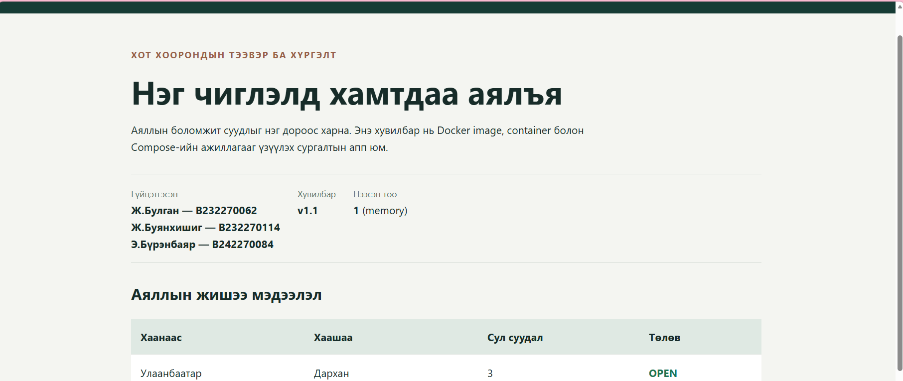
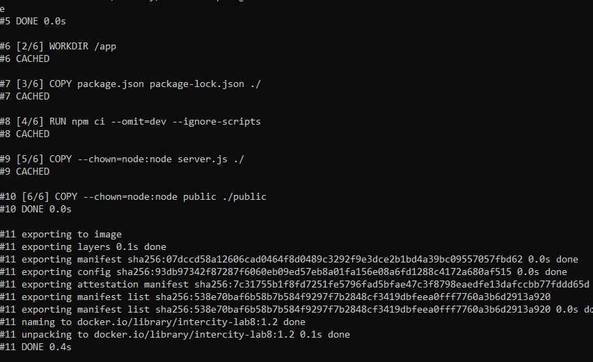
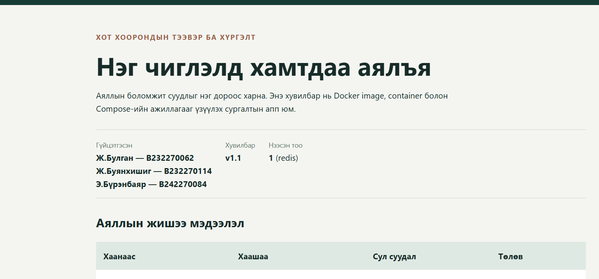

# Лаборатори 8 — Dockerfile бичих, Image бүтээх, ажиллуулах

**Хичээл:** CS316 — Программ хангамж хөгжүүлэлтийн процесс

**Төсөл:** Хот хоорондын тээвэр ба хүргэлтийн Intercity систем

## 1. Багийн бүрэлдэхүүн

| № | Гишүүний нэр | Оюутны код |
|---|---|---|
| 1 | Ж.Булган | B232270062 |
| 2 | Ж.Буянхишиг | B232270114 |
| 3 | Э.Бүрэнбаяр | B242270084 |

Лабораторийн ажлыг гурван гишүүн хамтран гүйцэтгэв. Жишээ аппын агуулгыг тохируулах, Dockerfile болон Compose тохиргоог шалгах, контейнер ажиллуулах, layer caching-ийн үр дүнг ажиглах, нотлох зураг болон тайланг бэлтгэх ажлуудад хамтран оролцов.

## 2. Ажлын зорилго

Intercity төслийн жишээ веб аппыг Docker image болгон бүтээж, контейнер дотор ажиллуулах, код өөрчлөгдөхөд build cache хэрхэн ашиглагдаж байгааг шалгах, Docker Compose ашиглан апп болон Redis-ийг хамтад нь ажиллуулахад оршино.

## 3. Ашигласан технологи

| Технологи | Хэрэглэсэн зориулалт |
|---|---|
| Node.js 22 Alpine | Веб сервер ажиллуулах орчин |
| HTML, CSS, JavaScript | Аяллын жагсаалт болон багийн мэдээлэл харуулах |
| Docker Desktop | Docker Engine болон контейнерүүдийг ажиллуулах |
| Docker 29.5.3 | Image бүтээх, контейнер ажиллуулах |
| Docker Compose v5.1.4 | App болон Redis сервисийг хамт удирдах |
| Redis 7 Alpine | Хуудасны хандалтын тоолуур хадгалах |
| Git, GitHub | Эх код болон гүйцэтгэлийн нотолгоог хадгалах |

Энэ лабораторийн апп нь Node.js-ийн үндсэн модулиудыг ашигласан бөгөөд нэмэлт npm dependency-гүй.

Redis-ийг зөвхөн тоолуурын жишээнд ашиглав. Энэ нь төслийн үндсэн өгөгдлийн сангийн PostgreSQL сонголтыг өөрчлөхгүй.

## 4. Аппын боломж

- Багийн гурван гишүүний нэр, оюутны кодыг харуулна.
- Аяллын чиглэл, сул суудал, төлөвийн жишээ мэдээлэл харуулна.
- Мэдээлэл шинэчлэх товчтой.
- Дан контейнерээр ажиллах үед тоолуурыг санах ойд хадгална.
- Compose ашиглах үед тоолуурыг Redis-д хадгална.

Аяллууд нь жишээ өгөгдөл бөгөөд энэ хувилбар бодит захиалга үүсгэхгүй.

| Зам | Үүрэг |
|---|---|
| `/` | Вебийн нүүр хуудас |
| `/health` | Апп ажиллаж байгаа эсэхийг шалгах |
| `/api/trips` | Аяллын жишээ мэдээлэл авах |
| `/api/visits` | Тоолуурын утгыг нэмэгдүүлж авах |

## 5. Файлын бүтэц

| Файл / хавтас | Үүрэг |
|---|---|
| `Dockerfile` | Image бүтээх заавар |
| `.dockerignore` | Build context-оос шаардлагагүй файлуудыг хасах |
| `.gitignore` | Git-д оруулахгүй файлуудыг тодорхойлох |
| `docker-compose.yml` | App болон Redis сервисийн тохиргоо |
| `server.js` | Веб сервер болон API |
| `public/index.html` | Веб хуудас |
| `package.json` | Аппын мэдээлэл |
| `package-lock.json` | npm суулгалтын lock файл |
| `cache-demo.ps1` | Cache туршилтад зориулсан анхны туслах скрипт |
| `evidence/` | Гүйцэтгэлийн зураг болон командын гаралт |

Cache туршилтыг эцэслэн Windows CMD-ийн build командаар гүйцэтгэсэн.

## 6. Docker орчныг шалгасан нь

Дараах командуудыг ажиллуулсан:

```bat
docker --version
docker compose version
docker info
```

Шалгалтаар Docker 29.5.3, Docker Compose v5.1.4 суусан бөгөөд Docker Desktop-ийн Linux Engine ажиллаж байгааг баталгаажуулав.

`docker --version` нь CLI-ийн хувилбарыг харуулдаг бол `docker info` командын Server хэсэг нь Engine-тэй холбогдсоныг батална.

## 7. Dockerfile

```dockerfile
FROM node:22-alpine

WORKDIR /app

COPY package.json package-lock.json ./
RUN npm ci --omit=dev --ignore-scripts

COPY --chown=node:node server.js ./
COPY --chown=node:node public ./public

ENV NODE_ENV=production
ENV PORT=3000

USER node

EXPOSE 3000

CMD ["node", "server.js"]
```

### Dockerfile-ийн тайлбар

| Заавар | Тайлбар |
|---|---|
| `FROM node:22-alpine` | Node.js агуулсан Alpine суурь image ашиглана. |
| `WORKDIR /app` | Контейнер доторх ажлын хавтсыг тогтооно. |
| `COPY package.json package-lock.json ./` | Суулгалтын мэдээллийг эхлээд хуулна. |
| `RUN npm ci --omit=dev --ignore-scripts` | Lock файлд тулгуурлан суулгалтын алхмыг ажиллуулна. |
| `COPY --chown=node:node ...` | Аппын файлуудыг node хэрэглэгчийн эзэмшилтэйгээр хуулна. |
| `ENV` | Ажиллах орчин болон портыг тохируулна. |
| `USER node` | Аппыг root бус хэрэглэгчээр ажиллуулна. |
| `EXPOSE 3000` | Контейнерийн ашиглах портыг баримтжуулна. |
| `CMD` | Контейнер эхлэхэд серверийг ажиллуулна. |

`EXPOSE` нь портыг компьютерт нийтлэхгүй. Портыг `docker run -p` эсвэл Compose-ийн `ports` тохиргоогоор холбоно.

## 8. Image бүтээж, контейнер ажиллуулсан нь

Лабораторийн хавтас:

```bat
cd /d C:\Users\zolbi\intercity-transport-delivery\lab8
```

Эхний image-ийг бүтээсэн:

```bat
docker build --progress=plain -t intercity-lab8:1.0 .
```

Контейнерийг ажиллуулсан:

```bat
docker run -d --name intercity-lab8-app -p 127.0.0.1:3000:3000 intercity-lab8:1.0
```

Контейнерийн төлөв болон логийг шалгасан:

```bat
docker ps
docker logs intercity-lab8-app
```

Вебийг `http://localhost:3000` хаягаар нээж, аяллын жишээ мэдээлэл болон багийн мэдээлэл харагдаж байгааг шалгав.

Дан контейнерээр ажиллах үед тоолуурын ард `(memory)` харагдсан.

## 9. Кодын өөрчлөлт ба layer caching

Вебийн гол гарчгийг дараах байдлаар өөрчилсөн:

| Өмнөх | Өөрчилсний дараах |
|---|---|
| Нэг чиглэлд хамтдаа | Нэг чиглэлд хамтдаа аялъя |

Өөрчлөлтийн дараа шинэ image бүтээж, гаралтыг файлд хадгалсан:

```bat
docker build --progress=plain -t intercity-lab8:1.2 . > evidence\build-cache.txt 2>&1
type evidence\build-cache.txt
```

Бодит build output дээр дараах үр дүн гарсан:

| Build алхам | Үр дүн |
|---|---|
| `WORKDIR /app` | `CACHED` |
| `COPY package.json package-lock.json ./` | `CACHED` |
| `RUN npm ci --omit=dev --ignore-scripts` | `CACHED` |
| `COPY --chown=node:node server.js ./` | `CACHED` |
| `COPY --chown=node:node public ./public` | `DONE` — дахин ажилласан |

Зөвхөн `public/index.html` өөрчлөгдсөн тул public хавтсыг хуулах алхам дахин ажилласан. Харин өөрчлөгдөөгүй dependency файлууд болон серверийн алхмууд өмнөх cache-ийг ашигласан.

Энэ апп нэмэлт npm dependency-гүй тул уг туршилт нь package таталтын хурдыг хэмжээгүй. Харин Docker-ийн өөрчлөгдөөгүй build алхмуудыг дахин ашиглах зарчмыг харуулсан.

Шинэ image-ээр контейнерийг дахин үүсгэсэн:

```bat
docker stop intercity-lab8-app
docker rm intercity-lab8-app
docker run -d --name intercity-lab8-app -p 127.0.0.1:3000:3000 intercity-lab8:1.2
```

Вебийг шинэчилж, өөрчилсөн гарчиг харагдаж байгааг баталгаажуулав.

Image-ийн `1.2` tag болон веб доторх `v1.1` бичвэр нь тусдаа утга юм. Image tag нь Docker image-ийг, вебийн бичвэр нь хуудасны хувилбарын шошгыг илэрхийлнэ.

### Ажиллаж буй апп



### Cache ашигласан build output



Бүрэн гаралт: [build-cache.txt](evidence/build-cache.txt)

## 10. Docker Compose ашигласан нь

Compose-оор дараах хоёр сервисийг хамтад нь ажиллуулсан:

| Сервис | Үүрэг |
|---|---|
| `app` | Node.js веб сервер |
| `redis` | Тоолуурын өгөгдөл хадгалах |

3000 порт ашиглаж байсан дан контейнерийг зогсоож, устгасан:

```bat
docker stop intercity-lab8-app
docker rm intercity-lab8-app
```

Дараа нь Compose-ийг ажиллуулсан:

```bat
docker compose up --build -d
docker compose ps
```

Бодит шалгалтын үр дүн:

| Контейнер | Image | Төлөв |
|---|---|---|
| `intercity-lab8-app-1` | `intercity-lab8:compose` | `Up (healthy)` |
| `intercity-lab8-redis-1` | `redis:7-alpine` | `Up (healthy)` |

Вебийн тоолуурын ард `(redis)` харагдсан нь апп Redis-тэй холбогдож, тоолуурын хүсэлт амжилттай ажилласныг батлав.

App нь Redis рүү Compose-ийн дотоод сүлжээгээр `redis` сервисийн нэрийг ашиглан холбогдоно. Redis-ийн 6379 портыг компьютерт нийтлээгүй.

Redis-д AOF болон `visits-data` named volume тохируулсан. Контейнерийг дахин үүсгэх үеийн өгөгдөл хадгалалтыг тусдаа туршилтаар энэ тайланд баталгаажуулаагүй.

### Compose ашиглан ажиллаж буй апп



### Төлөв болон логийг хадгалах команд

```bat
docker compose logs --no-color --tail=30 app redis > evidence\compose-logs.txt 2>&1
docker compose ps > evidence\compose-status.txt
```

- [Контейнерүүдийн төлөв](evidence/compose-status.txt)
- [App болон Redis-ийн лог](evidence/compose-logs.txt)

`/health` нь аппын ажиллаж байгааг шалгана. Redis-тэй холбогдож буй эсэхийг `/api/visits` хүсэлт болон вебийн `(redis)` тэмдэглэгээгээр давхар шалгасан.

## 11. Гүйцэтгэлийн нотолгоо

| Файл | Нотлох зүйл |
|---|---|
| `evidence/app-running.png` | Контейнер дотор ажиллаж буй апп, багийн мэдээлэл |
| `evidence/build-cache.png` | Кодын өөрчлөлтийн дараах cache ашиглалт |
| `evidence/build-cache.txt` | Build-ийн бүрэн гаралт |
| `evidence/compose.png` | Redis ашиглаж буй веб |
| `evidence/compose-status.txt` | App болон Redis контейнерийн төлөв |
| `evidence/compose-logs.txt` | Хоёр сервисийн лог |

Лабораторийн үндсэн хүлээлгэн өгөх материал болох Dockerfile болон хоёр screenshot-ийг бэлтгэсэн. Нэмэлтээр аппын эх код, Compose тохиргоо болон командын гаралтуудыг оруулав.

## 12. GitHub-д хадгалсан нь

Repository:

https://github.com/Buyka1108/intercity-transport-delivery

Лабораторийн branch:

`feature/lab8-docker`

Код, Compose тохиргоо болон нотолгоонуудыг нэмсэн commit:

`353e566` — `Add Lab 8 Docker app, Compose setup and execution evidence`

Уг commit-ийг `origin/feature/lab8-docker` салбар руу амжилттай push хийсэн.

## 13. Дүгнэлт

Манай баг Intercity жишээ аппын Dockerfile-ийг бэлтгэж, image бүтээн контейнер дотор ажиллуулав. Вебийн гарчгийг өөрчилсний дараа дахин build хийхэд өөрчлөгдөөгүй алхмууд cache ашиглаж, public хавтсыг хуулах алхам дахин ажилласныг ажиглав. Мөн Docker Compose ашиглан app болон Redis-ийг хамтад нь ажиллуулж, хоёр контейнер healthy төлөвтэй болон апп Redis-тэй холбогдсоныг баталгаажуулав.

## Эх сурвалж

- Лаборатори 8-ын өгөгдсөн удирдамж.
- Docker build cache: https://docs.docker.com/build/cache/optimize/
- Docker cache-ийн ажиллагаа: https://docs.docker.com/get-started/docker-concepts/building-images/using-the-build-cache/